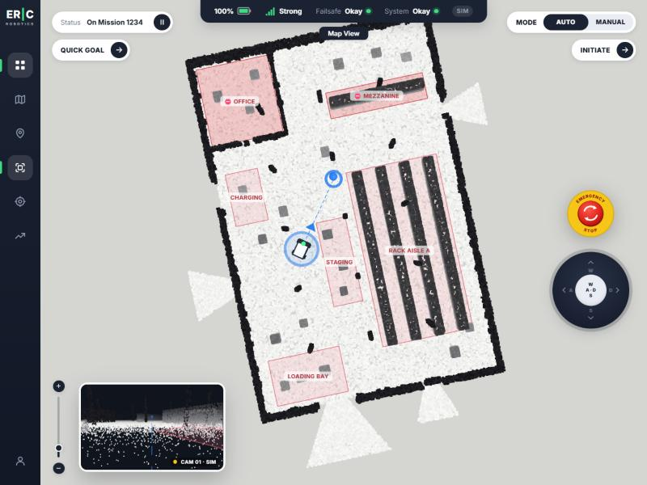
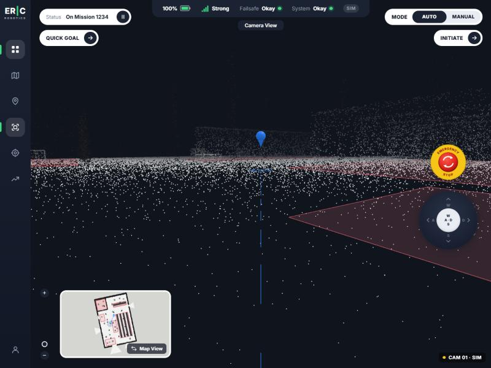
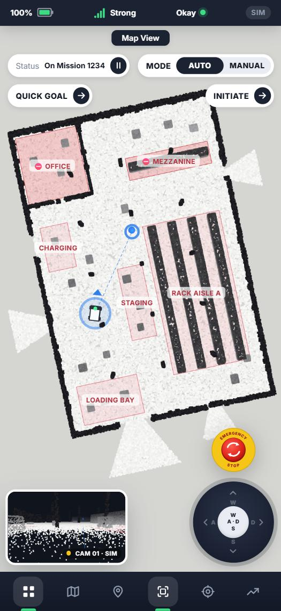

Uploading insight-io-demo.mp4…
https://drive.google.com/file/d/1kGOkiWjHvHCymyBYMmZzbDQRpFY5nGkm/view?usp=sharing


# Insight.IO: Robot Operations Dashboard

A self-hosted recreation of ERIC Robotics' **Insight.IO** dashboard. It shows a live **3D point-cloud map** and a **camera feed** that swap places, with mission controls, a WASD direction pad, an emergency stop and an optional **ROS 2 integration** through rosbridge.



| Camera view (simulated robot camera) | Phone layout |
| --- | --- |
|  |  |

---

## Quick start

Requirements: **Node.js 18+** (tested on Node 22) and npm.

```bash
git clone <this-repo> insight-io
cd insight-io
npm install
npm run dev          # http://localhost:5173
```

Production build, served locally:

```bash
npm run build
npm run preview      # http://localhost:4173
```

After `npm install` the app needs no internet connection. The fonts are bundled from npm and the sample map is in `public/data`.

### Using your own data

| What | How |
| --- | --- |
| **Camera video** | Put an MP4 at `public/media/camera.mp4`, or **drag a video file onto the dashboard**. The file is not git-ignored, so commit it to ship it with the repo (keep it under ~20 MB). |
| **Point-cloud map** | **Drag any `.pcd` file** (ASCII, binary or binary_compressed) onto the dashboard; the sample warehouse's zones and walls are cleared. Or change `cloud` in `public/data/map.json`. |
| **Zones / start pose** | Edit `public/data/map.json` (map frame, metres). |
| **Regenerate sample map** | `npm run generate:map` |

When no video and no ROS camera are available, the camera view falls back to a **simulated first-person render** from the robot's position in the point cloud, so the view always works.

---

## Features

| Area | Behaviour |
| --- | --- |
| **Map / Camera swap** | Click the picture-in-picture window to swap the main view with the inset. Both views stay mounted, so the swap animates and the WebGL contexts are kept. The top tab shows *Map View* / *Camera View*. |
| **3D map** | Three.js point cloud. Drag to pan, right-drag to rotate/tilt into 3D, scroll to zoom. The zoom slider stays in sync with the scroll wheel. Zones (no-go / slow) are drawn as labelled overlays. |
| **Status bar** | Battery %, signal, failsafe, system health and the ROS connection (`ROS Live` / `Sim`). |
| **Mission status** | `On Mission 1234`, paused, complete, manual or E-stop, with a pause/resume button. |
| **Quick Goal → Initiate** | Click QUICK GOAL, then click the map to drop a goal (goals inside no-go zones are rejected). INITIATE starts the mission; the robot drives there and the mission completes when it arrives. |
| **Mode AUTO / MANUAL** | MANUAL enables the direction pad and the **W A S D / arrow keys**. Switching to MANUAL pauses the running mission. |
| **Emergency stop** | Halts all motion immediately, shows a red frame around the screen, sets Failsafe to *Engaged* and blocks resuming until released. |
| **Sidebar** | Dashboard (fit map), Swap map / camera, Drop goal, Toggle zones, Follow robot, Telemetry drawer. Icons stay highlighted while their toggle is on. |
| **Responsive** | Desktop, tablet and phone (portrait and landscape). Below 640 px the sidebar becomes a bottom nav bar and the controls compact; on landscape phones the E-stop and pad move into a row at the bottom. |

---

## ROS 2 integration (bonus)

The dashboard connects to a [rosbridge](https://github.com/RobotWebTools/rosbridge_suite) websocket through **roslibjs**. If it can't connect, it keeps running on the built-in simulator and retries in the background (8 s, 16 s, 32 s, then every 60 s; the browser logs each failed attempt). The status bar chip shows which source is active.

**Try it without ROS:** a small mock rosbridge fakes a robot (odometry, the warehouse point cloud, a camera image, battery) and reacts to `/cmd_vel` and `/goal_pose`:

```bash
npm run mock:ros     # terminal 1: ws://localhost:9090
npm run dev          # terminal 2: the chip turns "ROS Live"
```

```bash
# Terminal 1: rosbridge
sudo apt install ros-$ROS_DISTRO-rosbridge-suite
ros2 launch rosbridge_server rosbridge_websocket_launch.xml   # ws://localhost:9090

# Terminal 2: play a bag (or run your robot / simulator)
ros2 bag play <your_bag> --loop

# Terminal 3
npm run dev
```

| Topic (default) | Type | Used for |
| --- | --- | --- |
| `/odom` | `nav_msgs/msg/Odometry` | Robot pose on the map (replaces the simulator) |
| `/points` | `sensor_msgs/msg/PointCloud2` | Live point-cloud map (xyz + optional rgb/intensity, decoded in the browser) |
| `/camera/image_raw/compressed` | `sensor_msgs/msg/CompressedImage` | Camera view |
| `/battery_state` | `sensor_msgs/msg/BatteryState` | Battery % |
| `/cmd_vel` ← | `geometry_msgs/msg/Twist` | Published in MANUAL mode (10 Hz) and on E-stop (zero twist) |
| `/goal_pose` ← | `geometry_msgs/msg/PoseStamped` | Published when a mission starts, resumes or is redirected (Nav2's goal topic) |

**Testing status:** tested end to end with `npm run mock:ros` (rosbridge v2 JSON protocol). It has not been tested against a physical robot.

**Known limitations**

- Pause and E-stop do not cancel a Nav2 goal (that needs the `navigate_to_pose` action, which roslibjs 1.x doesn't support for ROS 2). E-stop publishes a zero twist on `/cmd_vel` at 10 Hz; a real robot still needs a hardware E-stop.
- No TF lookups: `/points` and `/odom` are drawn in the frame they arrive in, so publish the cloud in `map`/`odom` for a fixed map. Each `/points` message replaces the displayed cloud.

Topic names and the bridge URL can be changed with env vars. Copy `.env.example` to `.env.local` and edit it. Set `VITE_ROS_ENABLED=false` to turn ROS off completely.

> ROS 1 bags can be converted with `rosbags-convert` or `ros2 bag convert`. The point cloud is drawn in the frame it arrives in, so publish it in `map`/`odom` for a fixed map.

---

## Architecture

```
src/
├── App.jsx                  Layout + wiring of UI state → sim / 3D world / ROS
├── config.js                Env-driven config (ROS URL, topics, media paths, robot limits)
├── state/dashboardReducer.js  All UI state (mode, mission, goal, E-stop, view, zoom…) in one reducer
├── hooks/
│   ├── useRobotEngine.js    Creates World + RobotSim + RosBridge; 60 fps loop; 4 Hz telemetry to React
│   └── useDriveInput.js     Merges keyboard + direction pad into the manual drive command
├── sim/
│   ├── RobotSim.js          Differential-drive model, go-to-goal controller, zone limits, battery
│   └── geometry.js          Point-in-polygon, angle helpers
├── three/
│   ├── World.js             Shared Three.js scene, map renderer (MapControls + CSS2D labels) and robot camera renderer
│   └── objects.js           Robot, goal marker, zone meshes
├── ros/
│   ├── RosBridge.js         roslibjs wrapper (lazy-loaded), subscriptions, publishers, auto-retry
│   └── pointcloud2.js       PointCloud2 → Float32Array decoder
└── components/              Sidebar, TopStatusBar, Pills (status / buttons / mode), EmergencyStop,
                             Joystick, ZoomSlider, ViewStage, MapView, CameraView, Overlays
scripts/generate-pcd.mjs     Builds the sample warehouse .pcd + map.json (seeded, reproducible)
scripts/mock-rosbridge.mjs   Fake robot over the rosbridge protocol, for trying the ROS path without ROS
```

**Design decisions**

- **High-rate data stays out of React.** Pose and velocities update in a single `requestAnimationFrame` loop that writes straight to Three.js. React gets a 4 Hz telemetry snapshot, so controls never re-render at 60 fps.
- **One scene, two renderers.** The map and the simulated camera render the same scene. Layers keep map-only overlays (robot halo, labels) out of the camera view. The cloud is drawn twice with different point materials: world-sized points so the floor looks solid from above, and fixed-pixel points for a lidar look up close.
- **ROS is optional.** roslibjs is loaded with a dynamic `import()` into its own chunk. Every ROS input has a local fallback (sim pose, static PCD, video or simulated camera), so the dashboard always works.
- **Map frame = ROS frame.** Everything lives under a group rotated from ROS z-up to Three's y-up, so ROS poses, PointCloud2 data and `map.json` coordinates can be used unchanged.
- **No runtime CDN.** Icons are inline SVG and fonts come from `@fontsource`. The app works offline once installed.

## Tech

React 18 · Vite 6 · Three.js r169 (PCDLoader, MapControls, CSS2DRenderer) · roslibjs 1.4 · plain CSS with design tokens.
